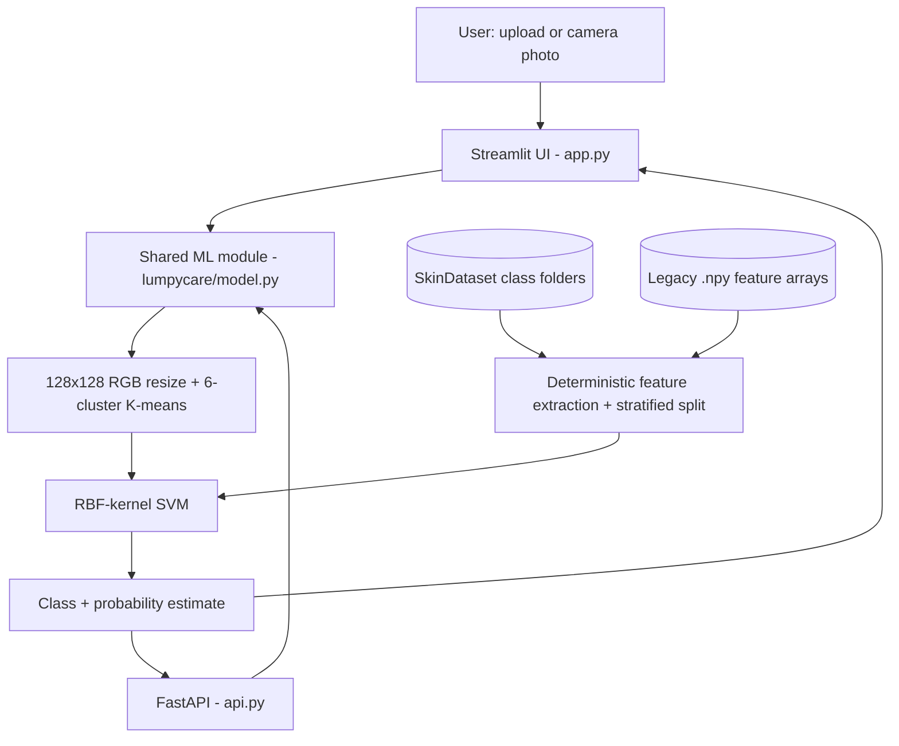

# 🐄 LumpyCare — Lumpy Skin Disease Screening

An educational image-screening prototype for cattle skin photos. The project uses OpenCV K-means image segmentation features and a scikit-learn Support Vector Machine (SVM) to classify an image into **Lumpy skin** or **Normal skin**.

> **Clinical safety:** This is a research/learning project, not a veterinary diagnostic device. A model output is not a diagnosis. Always consult a qualified veterinarian before taking animal-health or treatment decisions.

## What is implemented

- Responsive Streamlit interface with overview, screening, model evaluation and session history.
- Image upload for JPG, JPEG, PNG and WEBP.
- Browser camera capture through Streamlit's camera input widget (still-photo capture, not continuous video).
- Image preview, predicted class, class probability estimates and CSV export.
- Session-only prediction history with CSV export and clear-history action.
- Held-out evaluation view: accuracy, confusion matrix, per-class precision/recall/F1 and class counts.
- Shared model/inference module used by both the Streamlit app and the optional FastAPI service.
- FastAPI health and image-prediction endpoints with upload validation and size limits.
- Automated unit/API validation tests.
- Headless OpenCV dependency for hosted environments; no Tkinter desktop dependency in the deployed app.

## Repository architecture



### Source files

| Path | Purpose |
|---|---|
| `app.py` | Streamlit user interface and session workflows |
| `lumpycare/model.py` | Shared preprocessing, training, evaluation and inference |
| `api.py` | Optional FastAPI inference service |
| `tests/` | Automated preprocessing and API validation tests |
| `requirements.txt` | Runtime and test dependencies |
| `.streamlit/config.toml` | Streamlit theme and server configuration |
| `features/` | Existing precomputed feature and label arrays, when supplied |
| `SkinDataset/` | Optional raw class-folder dataset |

## Machine-learning method

1. Read an RGB image and resize it to **128 × 128**.
2. Reshape pixels into RGB vectors.
3. Apply OpenCV K-means with **six clusters** to create a segmented image representation.
4. Flatten the segmented image into a 49,152-value feature vector.
5. Train an RBF-kernel SVM with `C=12`.
6. Use a stratified 80/20 train/test split with a fixed split seed. The SVM is fitted only on the training partition; the held-out partition is used for reported evaluation.

### Training data source and reproducibility

The preferred source is the original image dataset in these exact folders:

```text
SkinDataset/
├── Lumpy skin/
└── Normal skin/
```

When both folders exist, the shared model module reprocesses the images with the same deterministic K-means routine used at inference. If raw folders are not available, the app falls back to the repository's existing arrays:

```text
features/
├── features.txt.npy
└── labels.txt.npy
```

**Legacy-array limitation:** these arrays were generated by the earlier notebook's random-centre K-means flow. They may not have been produced with the deterministic seed now used for inference. For reproducible training/inference, provide the raw class folders and let the current pipeline regenerate features. The app reports which data source was loaded.

## Evaluation and metrics

The evaluation page reports:
- Accuracy on the held-out test split
- Confusion matrix for the two classes
- Per-class precision, recall and F1-score
- Number of samples in each class and split sizes

No accuracy value is hard-coded in this README. The value displayed by the running app is calculated from the data available in that deployment. Results depend on dataset quality, class balance, duplicates, capture conditions and the split. A single random hold-out score is not external validation and must not be interpreted as real-world clinical performance.

## Run locally

Python 3.11 or 3.12 is recommended for broad scientific-package wheel support.

### 1. Clone and create an environment

```bash
git clone https://github.com/LingamGanesh/Lumpy-Skin-Disease-Detection.git
cd Lumpy-Skin-Disease-Detection
python -m venv .venv
```

Activate it:

**Windows PowerShell**
```powershell
.venv\Scripts\Activate.ps1
```

**macOS / Linux**
```bash
source .venv/bin/activate
```

### 2. Install dependencies

```bash
python -m pip install --upgrade pip
pip install -r requirements.txt
```

### 3. Start the Streamlit application

```bash
streamlit run app.py
```

Open the local URL printed by Streamlit (usually `http://localhost:8501`). Camera capture requires browser camera permission; localhost is treated as a secure context by modern browsers.

## FastAPI service

The API is an optional second entry point; the Streamlit app does not require the API server to run.

Start it in a separate terminal:

```bash
uvicorn api:app --host 127.0.0.1 --port 8000 --reload
```

Interactive API documentation: `http://127.0.0.1:8000/docs`

### Endpoints

| Method | Endpoint | Description |
|---|---|---|
| GET | `/health` | Loads/checks the model and reports its data source |
| POST | `/predict` | Accepts one multipart image field named `file` |

Example:

```bash
curl -X POST "http://127.0.0.1:8000/predict" \
  -F "file=@cattle-skin.jpg"
```

Successful prediction response contains `prediction`, `class_id`, `confidence`, class-wise `probabilities`, and a clinical-use disclaimer. Supported content types are JPEG, PNG and WEBP; uploads are limited to 10 MB. The API returns appropriate 4xx errors for invalid uploads and 503 when model preparation fails.

## Tests

Run:

```bash
pytest -q
```

The tests cover deterministic feature extraction, invalid image input, API content-type validation and unavailable-model handling. They do not replace an end-to-end test with the complete real dataset or browser camera permission testing.

## Deployment

### Streamlit Community Cloud

1. Push this repository to GitHub.
2. In Streamlit Community Cloud, create an app from `LingamGanesh/Lumpy-Skin-Disease-Detection`.
3. Select branch `main` and main file path `app.py`.
4. Choose Python 3.11 or 3.12 in Advanced settings if the runtime selector is available.
5. Deploy and confirm the dataset files/folders are present in the deployed repository.

### FastAPI deployment

Deploy `api:app` using an ASGI server such as Uvicorn. Ensure the same dataset files are included in the deployment image. Configure HTTPS in the hosting platform before accepting external traffic. Do not expose this prototype as a clinical decision service.

## Screenshots

Screenshots are intentionally not fabricated. Capture the running application after deployment and add genuine images under `docs/screenshots/` (for example, `overview.png`, `screening.png`, and `evaluation.png`) before publishing screenshots here.

## Current limitations and future work

- Replace the legacy feature-array fallback with versioned, reproducible training artifacts.
- Add subject-level and farm-level split strategies to reduce image leakage between train and test sets.
- Evaluate on an independent, veterinarian-labelled external dataset and report sensitivity, specificity, ROC-AUC, confidence intervals and calibration.
- Compare the current SVM baseline with transfer-learning CNN models only when enough validated data is available.
- Add secure, consent-based persistent case records and role-based access if the project moves beyond session-only history.
- Add monitoring for image quality, distribution shift and model-version changes.
- Conduct browser/device QA for camera permissions and responsive layouts before production use.

## License

No license is declared in this repository. Contact the repository owner before reusing or redistributing the code or dataset.
